# 👋 &nbsp;Hi there

Hey, I'm Filbert, a programming student from Indonesia, currently learning Python and exploring the world of software development.

Most of my coding journey so far has been focused on learning through projects, experimenting with different technologies, and improving my programming skills. I've worked on school projects and personal projects involving HTML, C++, and Python.

I'm also learning through Kodland lessons, where I continue to develop my understanding of programming and problem-solving. Some of my projects include a personal portfolio, a narcotics awareness website, and EcoPath AI (a climate-focused website that explores the use of AI).

&nbsp;

## 🚀 &nbsp;What I'm building

| Project | What it does |
| --- | --- |
| 🌱 [**EcoPath AI**](#) | An AI-powered climate website that helps users understand their environmental impact, analyze their lifestyle, and discover ways to live more sustainably. |
| 💊 [**Dangers of Narcotics**](#) | An educational website about narcotics, their effects, and the dangers of drug abuse. |
| 💻 [**Personal Portfolio**](#) | My personal website to showcase my programming journey, projects, and things I've been learning. |
| 🤖 [**Discord Pokémon Bot**](#) | A Discord bot built with Python that lets users interact with Pokémon through commands and interactive features. |

&nbsp;

## 📚 &nbsp;What I'm learning

- Python – Learning programming fundamentals and building small applications.
- HTML & CSS – Creating and designing websites.
- C++ – Exploring programming logic and problem-solving.
- Flask – Learning how to build web applications with Python.
- AI Integration – Experimenting with AI tools like Google Gemini.

&nbsp;

## 🧰 &nbsp;My toolbox

&nbsp;

## 📊 &nbsp;GitHub Stats

